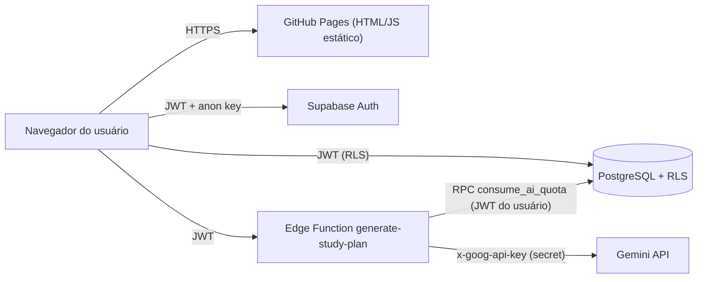
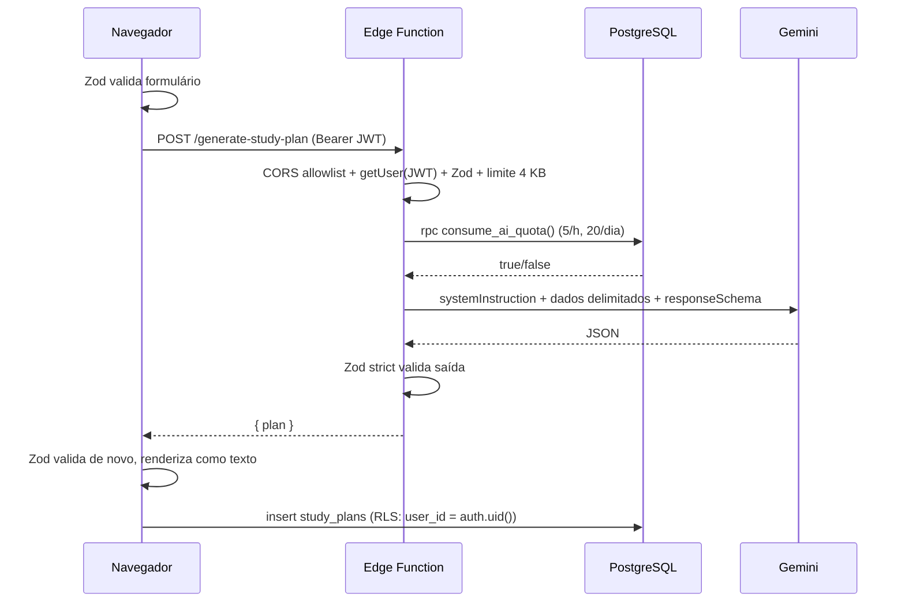

# Arquitetura — StudyFlow AI

## Visão geral

| Camada | Tecnologia | Confiança | Responsabilidade |
| --- | --- | --- | --- |
| Frontend | React 19 + TS + Vite, GitHub Pages | **Não confiável** (código público) | UI, validação de conveniência (Zod), renderização segura |
| Auth | Supabase Auth (PKCE) | Confiável | Identidade, JWT, confirmação de e-mail, Redirect URLs |
| Banco | PostgreSQL + RLS | Confiável | Isolamento por `auth.uid()`, CHECK constraints, limites |
| Backend | Supabase Edge Function (Deno) | Confiável | CORS, JWT, Zod, quota, chamada ao Gemini, validação da saída |
| IA | Gemini API (Structured Output) | **Não confiável** (saída) | Gera JSON de cronograma; sem ferramentas nem acesso ao banco |

## Fluxo "gerar e salvar cronograma"

## Decisões

- **Sem `service_role`**: a Edge Function usa o JWT do próprio usuário; a quota é aplicada por função `SECURITY DEFINER` que só opera sobre `auth.uid()`.
- **Salvar pelo cliente**: o insert ocorre direto pelo PostgREST, protegido por RLS + CHECK constraints + limite de 100 planos. O plano salvo é revalidado na leitura.
- **CSP via `<meta>`**: GitHub Pages não permite cabeçalhos; a política é injetada no build (`vite.config.ts`).
- **Sem roteador**: aplicação de página única sem rotas, evitando problemas de 404 no GitHub Pages e open redirect.
- **Esquemas duplicados** (`src/lib/validation.ts` e a Edge Function): Deno e Vite têm resolvedores diferentes; a duplicação é intencional e deve ser mantida em sincronia.
